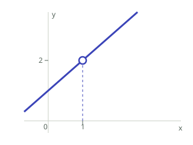

## مفهوم حد {#limit-idea}

وقتی می‌نویسیم $\lim_{x \to a} f(x) = L$ یعنی هرچه $x$ به $a$ نزدیک‌تر شود، مقدار $f(x)$ به $L$ نزدیک‌تر می‌شود. مقدار خود تابع در نقطه‌ی $a$ در حد هیچ نقشی ندارد؛ تابع حتی می‌تواند در $a$ تعریف نشده باشد.

مثال معروف تابع زیر است که در $x = 1$ تعریف نشده، اما حد دارد:

$$f(x) = \frac{x^2 - 1}{x - 1} = \frac{(x-1)(x+1)}{x-1} = x + 1 \quad (x \neq 1)$$

پس $\lim_{x \to 1} f(x) = 2$، با اینکه $f(1)$ وجود ندارد.

**حد چپ و راست.** حد راست ($x \to a^+$) یعنی نزدیک شدن از مقادیر بزرگ‌تر از $a$ و حد چپ ($x \to a^-$) از مقادیر کوچک‌تر. حد وجود دارد فقط اگر هر دو وجود داشته باشند و با هم برابر باشند.

:::نکته
برای تابع‌هایی مثل $|x|$، علامت و جزء صحیح، همیشه حد چپ و راست را جدا حساب کنید.
:::

:::خلاصه
- حد یعنی رفتار تابع **نزدیک** نقطه، نه **در** نقطه.
- اگر بعد از جای‌گذاری $\frac{0}{0}$ شد، عبارت را ساده کنید (تجزیه، گویا کردن).
- حد وجود دارد ⟺ حد چپ = حد راست.
:::

:::تست {#q-lim-basic}
منبع: تألیفی
سطح: آسان
حوزه: عمومی
نوع: محاسباتی
زمان: 40
صورت:
حاصل $\lim_{x \to 1} \frac{x^2 - 1}{x - 1}$ کدام است؟
- [ ] $0$
- [ ] $1$
- [x] $2$
- [ ] وجود ندارد
توضیح: صورت را تجزیه کنید: $\frac{(x-1)(x+1)}{x-1} = x + 1$. حالا با جای‌گذاری $x = 1$ جواب $2$ می‌شود.
راه‌حل سریع: حالت $\frac{0}{0}$ است؛ با هوپیتال مشتق صورت و مخرج: $\frac{2x}{1} \to 2$.
فلش‌کارت: limit-def
:::

:::تست {#q-one-sided}
منبع: تألیفی
سطح: متوسط
حوزه: عمومی
نوع: مفهومی
صورت:
برای تابع $f(x) = \frac{|x|}{x}$، حاصل $\lim_{x \to 0} f(x)$ کدام است؟
- [ ] $1$
- [ ] $-1$
- [ ] $0$
- [x] وجود ندارد
توضیح: برای $x > 0$ مقدار تابع $1$ و برای $x < 0$ مقدار آن $-1$ است. حد راست $1$ و حد چپ $-1$ است؛ چون برابر نیستند، حد وجود ندارد.
زاویه‌ی دیگر: نمودار این تابع دو نیم‌خط افقی در ارتفاع $1$ و $-1$ است که در صفر به هم نمی‌رسند؛ «پرش» در نمودار یعنی حد وجود ندارد.
فلش‌کارت: one-sided
:::

:::فلش‌کارت {#limit-def}
عنوان: حد در نقطه‌ای که تابع تعریف نشده
نکته: حد به مقدار تابع در خود نقطه بستگی ندارد؛ در حالت صفر‌صفرم، عامل مشترک را ساده کنید.
فرمول: \lim_{x\to 1}\frac{x^2-1}{x-1}=2
:::

:::فلش‌کارت {#one-sided}
عنوان: شرط وجود حد
نکته: حد وجود دارد فقط وقتی حد چپ و حد راست هر دو وجود داشته باشند و برابر باشند.
فرمول: \lim_{x\to a^-}f=\lim_{x\to a^+}f
:::

## حدهای مهم و هم‌ارزی {#special-limits}

چند حد پایه که تقریباً در همه‌ی تست‌ها به کار می‌آیند ($x$ بر حسب رادیان):

$$\lim_{x \to 0} \frac{\sin x}{x} = 1 \qquad \lim_{x \to 0} \frac{1 - \cos x}{x^2} = \frac{1}{2} \qquad \lim_{x \to \infty} \left(1 + \frac{1}{x}\right)^x = e$$

از این حدها **هم‌ارزی‌ها** نزدیک صفر به دست می‌آیند:

| عبارت (وقتی $x \to 0$) | هم‌ارز |
| --- | --- |
| $\sin x$ و $\tan x$ | $x$ |
| $1 - \cos x$ | $\frac{x^2}{2}$ |
| $\ln(1 + x)$ | $x$ |
| $e^x - 1$ | $x$ |

:::تله
هم‌ارزی را فقط در **ضرب و تقسیم** به کار ببرید. در جمع و تفریق ممکن است جمله‌های مهم حذف شوند؛ مثلاً $\tan x - \sin x$ را نمی‌شود با $x - x = 0$ جایگزین کرد.
:::

:::خلاصه
- $\sin x \sim x$، $\tan x \sim x$، $1 - \cos x \sim \frac{x^2}{2}$ وقتی $x \to 0$.
- هم‌ارزی فقط در ضرب و تقسیم.
- زاویه حتماً بر حسب رادیان.
:::

:::تست {#q-sin3x}
منبع: تألیفی
سطح: آسان
حوزه: عمومی
نوع: محاسباتی
زمان: 30
صورت:
حاصل $\lim_{x \to 0} \frac{\sin 3x}{x}$ کدام است؟
- [ ] $0$
- [ ] $1$
- [x] $3$
- [ ] $\frac{1}{3}$
توضیح: صورت و مخرج را در $3$ ضرب و تقسیم کنید: $3 \cdot \frac{\sin 3x}{3x} \to 3 \cdot 1 = 3$.
راه‌حل سریع: $\sin 3x \sim 3x$، پس $\frac{3x}{x} = 3$.
فلش‌کارت: sin-limit, equivalents
:::

:::تست {#q-cos2x}
منبع: تألیفی
سطح: متوسط
حوزه: عمومی
نوع: محاسباتی
صورت:
حاصل $\lim_{x \to 0} \frac{1 - \cos 2x}{x^2}$ کدام است؟
- [ ] $\frac{1}{2}$
- [ ] $1$
- [x] $2$
- [ ] $4$
توضیح: از $1 - \cos u \sim \frac{u^2}{2}$ با $u = 2x$: صورت هم‌ارز $\frac{4x^2}{2} = 2x^2$ است و حاصل $2$.
راه‌حل سریع: $1 - \cos 2x = 2\sin^2 x \sim 2x^2$.
فلش‌کارت: equivalents
:::

:::تست {#q-tan-minus-sin}
منبع: تألیفی
سطح: سخت
حوزه: عمومی
نوع: تحلیلی
صورت:
حاصل $\lim_{x \to 0} \frac{\tan x - \sin x}{x^3}$ کدام است؟
- [x] $\frac{1}{2}$
- [ ] $0$
- [ ] $1$
- [ ] $\frac{1}{6}$
توضیح: از $\tan x$ فاکتور بگیرید: $\tan x - \sin x = \tan x\,(1 - \cos x)$. حالا هم‌ارزی در ضرب مجاز است: $x \cdot \frac{x^2}{2} = \frac{x^3}{2}$، پس جواب $\frac{1}{2}$.
راه‌حل سریع: $\tan x\,(1 - \cos x) \sim x \cdot \frac{x^2}{2}$.
زاویه‌ی دیگر: با بسط تیلور: $\tan x = x + \frac{x^3}{3} + \cdots$ و $\sin x = x - \frac{x^3}{6} + \cdots$؛ تفاضل $\frac{x^3}{2}$ است. گزینه‌ی $0$ همان تله‌ی هم‌ارزی در تفریق است.
فلش‌کارت: equivalents
:::

:::فلش‌کارت {#sin-limit}
عنوان: حد معروف سینوس
نکته: نزدیک صفر، سینوس و زاویه (بر حسب رادیان) تقریباً برابرند.
فرمول: \lim_{x\to 0}\frac{\sin x}{x}=1
:::

:::فلش‌کارت {#equivalents}
عنوان: هم‌ارزی‌های نزدیک صفر
نکته: سینوس و تانژانت هم‌ارز x، یک منهای کسینوس هم‌ارز نصف مجذور x؛ فقط در ضرب و تقسیم.
فرمول: 1-\cos x \sim \frac{x^2}{2}
:::

## پیوستگی {#continuity}

تابع $f$ در نقطه‌ی $a$ **پیوسته** است اگر سه شرط برقرار باشد: $f(a)$ تعریف شده باشد، حد در $a$ وجود داشته باشد، و این دو با هم برابر باشند:

$$\lim_{x \to a} f(x) = f(a)$$

تابع‌های چندضابطه‌ای معمولاً در نقطه‌ی مرزی بررسی می‌شوند. اگر حد وجود داشته باشد ولی با مقدار تابع برابر نباشد، ناپیوستگی **رفع‌شدنی** است؛ اگر حد چپ و راست متفاوت باشند، ناپیوستگی **جهشی** است.

:::خلاصه
- پیوستگی = (مقدار تعریف‌شده) + (حد موجود) + (برابری آن دو).
- در چندضابطه‌ای‌ها حد را از هر دو طرف نقطه‌ی مرزی حساب کنید.
:::

:::تست {#q-cont-k}
منبع: تألیفی
سطح: آسان
حوزه: عمومی
نوع: محاسباتی
صورت:
تابع زیر به ازای چه مقدار $k$ در $x = 2$ پیوسته است؟
$$f(x) = \begin{cases} \frac{x^2 - 4}{x - 2} & x \neq 2 \\ k & x = 2 \end{cases}$$
- [ ] $0$
- [ ] $2$
- [x] $4$
- [ ] به ازای هیچ مقداری
توضیح: برای $x \neq 2$ داریم $f(x) = x + 2$، پس حد در $2$ برابر $4$ است. برای پیوستگی باید $k = f(2) = 4$ باشد.
فلش‌کارت: continuity-def
:::

:::فلش‌کارت {#continuity-def}
عنوان: تعریف پیوستگی
نکته: مقدار تابع در نقطه باید با حدش در همان نقطه برابر باشد.
فرمول: \lim_{x\to a}f(x)=f(a)
:::
